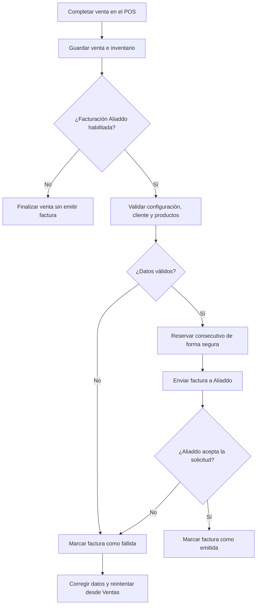

# Guía de parametrización de facturación electrónica con Aliaddo

Esta guía explica cómo configurar **Electronic Invoicing (Aliaddo)** para una
empresa y cómo preparar el sistema para emitir facturas electrónicas desde el
POS. Los nombres entre comillas corresponden a los campos del panel.

> **Importante:** los códigos, la resolución y las credenciales deben ser los
> asignados a la empresa por Aliaddo y la DIAN. Los valores de ejemplo de esta
> guía describen formatos; no deben copiarse como datos reales de facturación.

## 1. Qué hace la integración

Cuando se completa una venta POS, Alfil SaaS usa la configuración de la empresa,
los datos tributarios del cliente y los productos de la venta para construir y
enviar una factura a Aliaddo. La emisión sucede después de guardar la venta: si
Aliaddo rechaza la solicitud o no está disponible, la venta y el movimiento de
inventario permanecen guardados. La factura queda marcada como fallida para
corregir los datos y reintentarla.



## 2. Antes de empezar

Ten disponibles estos datos para la misma empresa que utilizará el POS:

- Acceso de tipo **empresa** a Alfil SaaS.
- Token API y URL HTTPS de Aliaddo para el ambiente que se va a utilizar.
- Para pruebas, el identificador de conjunto de pruebas (`Test set ID`) entregado
  por Aliaddo.
- Datos vigentes de la resolución de numeración de facturación electrónica de
  la DIAN: clave técnica, número, prefijo, rango y fechas de vigencia.
- Códigos documentales, tributarios, de moneda, forma de pago, producto y
  ubicación confirmados por Aliaddo/DIAN.
- Una sucursal, productos y un cliente que tenga identificación tributaria.

No uses credenciales de producción en pruebas. No compartas el token en chats,
capturas de pantalla ni archivos públicos.

## 3. Abrir el panel

1. Inicia sesión con la cuenta de la empresa.
2. Abre **Settings / Ajustes**.
3. Busca la sección **Electronic Invoicing (Aliaddo)**.
4. Completa los campos por grupo, como se describe a continuación.
5. Mantén desactivada la opción de emisión automática mientras reúnes y verificas
   los datos. Actívala al final, antes de guardar la configuración habilitada.

## 4. Configurar la conexión

| Campo | Qué ingresar |
|---|---|
| **Enable automatic electronic invoicing** | Actívalo solo cuando termines y hayas revisado la parametrización. |
| **API base URL** | URL HTTPS del ambiente Aliaddo. El valor inicial es `https://orka.test.aliaddo.net`; para producción usa la URL oficial asignada por el proveedor. |
| **Mode (Test or Production)** | `Test` para el ambiente de pruebas; `Production` únicamente cuando Aliaddo confirme que la cuenta está habilitada para producción. |
| **Test set ID** | UUID del conjunto de pruebas entregado por Aliaddo. Alfil SaaS lo requiere si la integración está habilitada en modo `Test`; no es obligatorio en `Production`. |
| **Aliaddo API token** | Pega el token. Se acepta con o sin el prefijo `Bearer`; el servidor elimina ese prefijo si está presente. Si ya hay un token guardado, deja el campo vacío para conservarlo. |

El token se almacena cifrado y no se devuelve al navegador. Si cambias de
ambiente, verifica que URL, token, modo y conjunto de pruebas correspondan todos
al mismo ambiente.

## 5. Configurar factura y numeración

| Campo | Qué ingresar |
|---|---|
| **Invoice document code** | Código del tipo de documento electrónico que Aliaddo indicó para la factura. |
| **Operation type** | Código del tipo de operación solicitado por Aliaddo para este documento. |
| **Document format** | Opcional en el esquema de Aliaddo; déjalo vacío si el proveedor no te indicó un formato. |
| **Invoice prefix** | Prefijo de factura configurado con Aliaddo/DIAN. Aliaddo lo marca opcional en el cuerpo; Alfil SaaS lo requiere para reservar y registrar la numeración del POS. |
| **Next consecutive number** | Siguiente número que debe utilizar Alfil SaaS dentro del rango autorizado. Debe ser un entero positivo y estar entre los límites de la resolución. |
| **Currency code** | Código ISO 4217 de tres letras de la moneda, por ejemplo `COP` si corresponde a la moneda de la empresa. |
| **Payment method code** | Código de medio/forma de pago admitido por Aliaddo para las ventas de la empresa. |
| **Payment term in days** | Plazo en días. Puede dejarse vacío si no aplica; el sistema lo trata como cero días. El máximo aceptado es 3650. |

El sistema reserva el consecutivo al iniciar la emisión y actualiza el siguiente
valor de forma transaccional para evitar que dos ventas reciban el mismo número.
La reserva ocurre antes de enviar la solicitud: si Aliaddo rechaza el documento o
se pierde la conexión, ese número ya puede haber quedado consumido y el reintento
utilizará el siguiente consecutivo. No reduzcas el contador para reutilizarlo;
consulta con Aliaddo cómo tratar números no emitidos.
Después de guardar, revisa el siguiente consecutivo antes de cambiarlo
manualmente. No lo reinicies ni lo reduzcas por debajo de un número ya utilizado.

## 6. Configurar sucursal, ubicación y productos

Estos campos son valores predeterminados que se envían en los documentos. Usa
los códigos oficiales aplicables a tu compañía y confirma con Aliaddo si todas
las sucursales pueden compartir la misma parametrización.

| Campo | Qué ingresar |
|---|---|
| **Branch region code / Branch region name** | Código DIAN de región/departamento y el nombre correspondiente a la sucursal emisora. |
| **Branch city code / Branch city name** | Código DIAN de municipio y nombre correspondiente a la sucursal emisora. |
| **Country code** | Código requerido para el país de facturación del comprador. Usa el código confirmado por Aliaddo. |
| **Country name** | Opcional; se envía como nombre del país si se conoce. |
| **Product standard type / Product standard code** | Opcionales en la línea. Complétalos solo si Aliaddo requiere la clasificación estándar de tus productos. |
| **Aliaddo tax code** | Requerido solo cuando la venta incluya productos con impuestos. Selecciona el código del catálogo de impuestos de Aliaddo que corresponda a los productos gravados. |

El código de unidad Aliaddo se selecciona dentro de cada producto en
**Productos**, junto a su unidad interna; no es un parámetro general de esta
pantalla. Solo se ofrecen las unidades de uso común para cantidad, peso y
volumen.

Los nombres y códigos son datos distintos. El panel no consulta ni valida estos
catálogos con Aliaddo; un código desconocido puede provocar el rechazo de la
factura. Si no hay impuestos en las líneas, no hace falta configurar un código
tributario y el POS omite `taxes`.

El desplegable de **Aliaddo tax code** incluye el catálogo de impuestos
documentado por Aliaddo:

| Código | Nombre |
|---|---|
| `01` | IVA |
| `02` | IC (impuesto al consumo departamental nominal) |
| `03` | ICA |
| `04` | INC (impuesto nacional al consumo) |
| `08` | IC porcentual |
| `20` | FtoHorticultura |
| `21` | Timbre |
| `22` | INC Bolsas |
| `23` | INCarbono |
| `24` | INCombustibles |
| `25` | Sobretasa Combustibles |
| `26` | Sordicom |
| `30` | IC Datos |
| `32` | ICL |
| `33` | INPP |
| `34` | IBUA |
| `35` | ICUI |
| `36` | ADV |
| `ZZ` | Otros tributos, tasas o contribuciones |

Esta lista es para `taxes`, no para `withholdings`. La documentación publica un
catálogo separado para retenciones (`05` ReteIVA, `06` ReteRenta, `07` ReteICA
y `ZZ` otras); la configuración actual del POS solo aplica un código de
impuesto y no asigna códigos de retención.

## 7. Configurar la resolución DIAN

Transcribe los datos de la resolución electrónica vigente:

| Campo | Qué ingresar |
|---|---|
| **Resolution technical key** | Clave técnica asignada a la resolución. Trátala como información sensible. |
| **Resolution prefix** | Opcional en la resolución. Si se deja vacío, el sistema usa **Invoice prefix**. |
| **Resolution number** | Número de resolución, como entero positivo. |
| **Authorized initial number** | Primer consecutivo autorizado. |
| **Authorized final number** | Último consecutivo autorizado; no puede ser menor que el inicial. |
| **Resolution valid from / Resolution valid until** | Fechas de inicio y fin de vigencia. La fecha final debe ser igual o posterior a la inicial. |

Antes de habilitar la emisión, confirma que la fecha actual esté dentro del
periodo de vigencia y que **Next consecutive number** esté dentro del rango
autorizado. Al llegar al límite final, solicita o configura la siguiente
resolución antes de emitir nuevas facturas.

## 8. Configurar datos tributarios predeterminados del comprador

| Campo | Qué ingresar |
|---|---|
| **Default person type** | Código predeterminado del tipo de persona aceptado por Aliaddo. |
| **Default tax regime** | Código predeterminado del régimen tributario. |
| **Default identification type code** | Código predeterminado del tipo de identificación. |
| **Default tax responsibility** | Código de responsabilidad tributaria predeterminado. |
| **Default responsibilities** | Código o valor de responsabilidades que solicita Aliaddo. |

Estos valores son opcionales y se usan como respaldo si el dato correspondiente
no se encuentra en la ficha individual del cliente. El documento final sí debe
contener los datos fiscales requeridos por Aliaddo. Ningún valor predeterminado
reemplaza la identificación tributaria ni los nombres y apellidos del comprador.

### Revisar la ficha del cliente

Antes de probar una factura:

1. Abre **Customers / Clientes** y crea o edita el cliente que se usará en el
   POS.
2. Completa el número de identificación tributaria.
3. Registra el tipo de identificación, tipo de persona, régimen y
   responsabilidades si los conoces para ese cliente.
4. Completa nombres y apellidos fiscales, correo, teléfono y dirección de
   facturación cuando correspondan.
5. Guarda el cliente y confirma que se seleccionará en la venta POS.

Los datos tributarios guardados en la ficha tienen prioridad sobre los valores
predeterminados de la empresa. Verifica los datos fiscales directamente con el
cliente; no uses los datos del cliente genérico/de mostrador para una factura que
requiera identificación.

## 9. Campos requeridos, opcionales y valores predeterminados

La fuente principal es [Modulo predeterminado.html](./Modulo%20predeterminado.html),
en particular el contrato `POST /v2/documents/invoices`. Ese endpoint marca
`code`, `typeOperation` y `lines` como requeridos. El esquema reutilizable
`FacturaRequest` también marca como requeridos `mode`, `consecutive`,
`currencyCode`, `dueAt`, `resolution`, `customer` y `totals`, entre otros campos
que dependen del tipo de documento. El POS envía una factura completa y mantiene
requisitos propios para manejar la numeración, por lo que su configuración puede
ser más estricta que el mínimo de la operación HTTP.

### Requisitos del POS y de los objetos anidados

| Campo o configuración | Requisito y origen |
|---|---|
| `code`, `typeOperation` | Requeridos por la operación; corresponden a **Invoice document code** y **Operation type**. |
| `mode`, `currencyCode`, `paymentMeanCode` | El POS los envía para el documento; configura el modo, moneda y medio de pago confirmados con Aliaddo. |
| `consecutive`, `prefix` | Alfil SaaS requiere la numeración para reservar y registrar facturas. El consecutivo debe estar dentro del rango DIAN; el prefijo del documento admite hasta 8 caracteres. |
| `dueAt` | El POS lo calcula a partir de la fecha de venta y **Payment term in days**. Si el plazo se deja vacío, usa 0 días. |
| `resolution` | El POS incluye resolución; el esquema exige `key`, `number`, `rangeInitial`, `rangeFinal`, `validFrom` y `validUntil`. `prefix` es opcional y usa el prefijo de factura como respaldo. |
| `customer` | El POS incluye el comprador; revisa los campos fiscales requeridos que se enumeran abajo. |
| `lines` | Requeridas por la operación; entre 1 y 100. Cada línea exige `code`, `name`, `unitMeasurementCode`, `price` y `quantity`. |
| `totals` | El POS incluye totales; `amount` es requerido en el objeto. Sus demás importes son opcionales en el esquema. |

No hay valores fiscales por defecto universales en el HTML: los ejemplos son
ilustrativos, no valores listos para producción. La aplicación inicia con URL de
pruebas y modo `Test`, usa cero días si no se configura un plazo, y deja que
Aliaddo aplique el valor documentado `isPresent: false` al omitir ese campo en
las líneas. Los códigos, datos del comprador y resolución deben corresponder a
la empresa; no los derives de ejemplos.

### Comprador y direcciones

El esquema `Cliente` marca como requeridos `companyName`, `personType`,
`regimeType`, `firstName`, `lastName`, `identification`, `digitCheck`,
`identificationTypeCode`, `billingCountryCode`, `billingRegionCode` y
`responsibilities`. Los tipos, régimen, tipo de identificación y
responsabilidades pueden provenir de la ficha del cliente o de los valores
predeterminados de la empresa; el número de identificación y los nombres deben
revisarse en el cliente. La sección **Schemas** del HTML no declara valores
predeterminados para estos campos fiscales; por eso los valores por defecto de
la empresa empiezan vacíos y el formulario solo permite códigos del enum:

| Configuración predeterminada | Valores permitidos |
|---|---|
| **Default person type** (`customer.personType`) | `"1"` persona jurídica; `"2"` persona natural. Se envía el código como texto, nunca la descripción. Para proveedores, Aliaddo nombra el campo `supplier.kind`; esta configuración predeterminada aplica al comprador del POS. |
| **Default tax regime** | `48` responsable de IVA; `49` no responsable de IVA. |
| **Default identification type code** | `11`, `12`, `13`, `21`, `22`, `31`, `41`, `42`, `47`, `48`, `50`, `91`, según el catálogo de tipos de identificación. |
| **Default tax responsibility** (`responsibleFor`) | `01`, `04`, `ZA`, `ZZ`. |
| **Default responsibilities** | `O-13`, `O-15`, `O-23`, `O-47`, `R-99-PN`. |

`digitCheck` debe enviarse como propiedad, aunque su valor dependa del caso
tributario. La validación del servidor también rechaza valores que no estén en
los enums publicados.

El HTML tiene una discrepancia interna: el esquema reutilizable `Cliente`
describe campos planos (`billingAddress`, `billingCountryCode`,
`billingRegionCode`, etc.), mientras que el ejemplo concreto del endpoint usa
objetos anidados `BillingAddress` y `ShippingAddress`. El POS conserva la forma
anidada del ejemplo de `POST /v2/documents/invoices`; confirma con Aliaddo cuál
forma aplica a la cuenta antes de pasar a producción. Correo, teléfono,
`responsibleFor` y `economicActivities` son opcionales.

### Productos, impuestos y totales

- Cada línea requiere `code`, `name`, `unitMeasurementCode`, `price` y
  `quantity`. El precio no puede ser negativo y la cantidad debe ser al menos 1.
  Configura el **código de unidad Aliaddo** dentro de cada producto en
  **Productos**; el POS envía también el nombre oficial asociado al código.
  Las opciones comunes son cantidad (`94` Unidad, `EA` cada, `C62` uno, `DZN`
  docena, `SET` conjunto), peso (`KGM` kilogramo, `GRM` gramo, `TNE` tonelada
  métrica, `LBR` libra, `ONZ` onza) y volumen (`LTR` litro, `MLT` mililitro,
  `MTQ` metro cúbico, `GLL` galón). Se descartan los demás códigos del catálogo.
  Si falta un código Aliaddo para algún producto de la venta, la emisión se
  detiene e indica qué producto debes completar.
  `standardType` y `standardCode` son opcionales; si se configuran, usa datos
  de los catálogos aplicables.
- `taxes` y `withholdings` son opcionales por línea, pero cuando apliquen deben
  llevar los campos `name`, `code`, `type`, `rate`, `amount` y `base`, con los
  códigos, bases, tarifas y valores calculados de acuerdo con la regla tributaria
  real. No agregues impuestos solo para hacer que un ejemplo cuadre.
- Los descuentos y cargos por línea se definen sobre el valor unitario. Si se
  usan, sus importes (`discountAmount` y `chargeAmount`) deben cuadrar con los
  valores unitarios y la cantidad de esa línea. En cada objeto de descuento o
  cargo se requieren `type`, `rate` y `amount`; `type` es `P` para porcentaje o
  `F` para valor fijo. Para el tipo `F`, Aliaddo indica que `rate` y `amount`
  deben ser iguales.
- No mezcles descuentos o cargos globales de factura con descuentos o cargos
  definidos en las líneas. El esquema también admite propina; su tarifa no
  puede superar el 10 % y el objeto requiere `base`, `rate` y `amount`.
- `totals.amount` es obligatorio. Anticipos, impuestos, retenciones, descuentos
  y cargos totales son opcionales en el esquema (`prepaymentAmount`,
  `taxesAmount`, `withholdingAmount`, `discountsAmount` y `chargesAmount`); si se
  envían, deben conciliar con el detalle y las reglas de cálculo de Aliaddo.

### Otros campos opcionales y condiciones

Entre los campos opcionales documentados por el proveedor están `format`,
`testSetId`, `prefix`, `currencyRate`, `orderReference`, `issuedAt`, `branch`,
`periodStartDate`, `periodEndDate`, `deliveryAt`, `incoterms`, `deliveryTerms`,
`terms`, `remark`, `tip`, `discounts` y `charges`. Aplican estas condiciones:

- `incoterms` solo es requerido para una factura de exportación.
- Si se incluye `branch`, Aliaddo requiere nombre, dirección, región y ciudad
  con sus códigos y nombres. El flujo automático de POS de Alfil SaaS envía la
  sucursal y, por tanto, requiere que sus datos estén completos.
- `prefix` tiene un máximo de 8 caracteres en la documentación de Aliaddo.
  La configuración de Alfil SaaS también limita el prefijo a 8 caracteres.
- `testSetId` es opcional en el esquema de Aliaddo, pero Alfil SaaS lo requiere
  cuando la integración está habilitada en modo `Test`.
- **Invoice document code** es una lista del esquema `FacturaRequest`; el
  formulario limita la selección a `01`, `02`, `03`, `04`, `05`, `07`, `08`,
  `20`, `25`, `27`, `30`, `35`, `40`, `45`, `50`, `55`, `60`, `91`, `92`,
  `93`, `94` y `95`. El esquema no define un código predeterminado: debe
  seleccionarse el que corresponda a la operación autorizada.
- **Operation type** tiene valores descritos por el esquema `FacturaElectronica`:
  `09`, `10`, `11`, `12`, `14`, `15`, `16`, `20`, `22`, `25`, `27`, `32`,
  `35`, `271`, `272`, `273`, `274`, `321`, `322`, `551`, `552`, `601`, `602`,
  `SS-CUDE`, `SS-CUFE`, `SS-POS`, `SS-SNum`, `SS-Reporte`, `SS-SinAporte` y
  `SS-Recaudo`. La lista depende del tipo de documento y del caso; selecciona
  únicamente el valor aplicable que Aliaddo haya habilitado.
- **Document format** admite `Estandar`, `Azul`, `Continental`, `Indigo`,
  `FacturaExportacion`, `MediaCarta` y `Tirilla`. **Product standard type**
  admite `001`, `010`, `020` y `999`.
- **INCOTERMS** es requerido para facturas de exportación (código `02`) y se
  selecciona por código en la configuración: `CFR` (costo y flete), `CIF`
  (costo, flete y seguro), `CIP` (transporte y seguro pagados hasta), `CPT`
  (transporte pagado hasta), `DAP` (entregado en un lugar), `DDP` (entregado
  con pago de derechos), `DPU` (entregada en lugar descargada), `EXW` (en
  fábrica), `FAS` (franco al costado del buque), `FCA` (franco transportista)
  y `FOB` (franco a bordo). Se envía el código en mayúsculas, nunca la
  descripción.
- **Payment method code** se selecciona entre los códigos más usados del
  catálogo Aliaddo: `10` efectivo, `13` crédito ahorro, `14` débito ahorro,
  `30` transferencia crédito, `31` transferencia débito, `42` consignación
  bancaria, `48` tarjeta crédito y `49` tarjeta débito. No se asigna un valor
  predeterminado porque depende del medio de pago utilizado por la empresa.
- Moneda, impuestos, regiones y ciudades no tienen listas completas declaradas
  en los esquemas consultados. La unidad de medida se configura por producto y
  el selector ofrece solo las opciones comunes de cantidad, peso y volumen; el
  medio de pago se limita a los códigos más usados documentados arriba.
- Para direcciones colombianas, región/departamento y municipio/ciudad se
  seleccionan de los catálogos Aliaddo: el catálogo de departamentos sincroniza
  código y nombre, y el de ciudades filtra sus 1.123 opciones según el
  departamento. La configuración valida que los códigos y nombres correspondan
  entre sí antes de guardarlos. Los archivos de catálogo se encuentran en
  `resources/js/pages/settings/components/aliaddo-settings.tsx` y
  `resources/data/aliaddo-colombia-cities.json`.
- Para empresas en Colombia, la configuración inicia con moneda `COP`, código
  de país `CO` y nombre de país `Colombia`. La moneda y el código de país son
  obligatorios en la emisión automática; el nombre del país es opcional y puede
  modificarse si la empresa factura en otra jurisdicción.
- `format` es opcional tanto en el esquema del proveedor como en la configuración
  del POS; si se deja vacío, no se envía.
- `prefix` es opcional en el esquema del proveedor, pero requerido por la emisión
  automática de Alfil SaaS para administrar el consecutivo y asociarlo a la venta.
- El código de impuesto es opcional si la venta no tiene impuestos; si hay
  impuestos en los productos, configura el código antes de emitir.
- `resolution.prefix` es opcional; el POS usa **Invoice prefix** cuando se deja
  vacío.
- `deliveryTerms`, `terms` y `remark` admiten hasta 800 caracteres cada uno.

### Ejemplo ilustrativo del cuerpo

Este JSON muestra la forma general del documento. Los códigos entre corchetes
son marcadores y **no son valores utilizables**; reemplázalos únicamente con los
datos oficiales entregados para la empresa. No incluyas el token de autorización
en el cuerpo ni en documentación compartida.

```json
{
  "code": "[CODIGO_FACTURA]",
  "typeOperation": "[CODIGO_OPERACION]",
  "mode": "Test",
  "format": "[FORMATO]",
  "testSetId": "[IDENTIFICADOR_DE_PRUEBAS]",
  "prefix": "[PREFIJO]",
  "consecutive": 1,
  "currencyCode": "COP",
  "dueAt": "AAAA-MM-DD",
  "paymentMeanCode": "[CODIGO_MEDIO_PAGO]",
  "branch": {
    "name": "[SUCURSAL]",
    "address": "[DIRECCION]",
    "regionCode": "[CODIGO_REGION]",
    "regionName": "[REGION]",
    "cityCode": "[CODIGO_CIUDAD]",
    "cityName": "[CIUDAD]"
  },
  "resolution": {
    "key": "[CLAVE_TECNICA]",
    "prefix": "[PREFIJO_RESOLUCION]",
    "number": 1,
    "rangeInitial": 1,
    "rangeFinal": 100,
    "validFrom": "AAAA-MM-DD",
    "validUntil": "AAAA-MM-DD"
  },
  "customer": {
    "companyName": "[NOMBRE_FISCAL]",
    "personType": "[TIPO_PERSONA]",
    "regimeType": "[REGIMEN]",
    "firstName": "[NOMBRES]",
    "lastName": "[APELLIDOS]",
    "identification": "[IDENTIFICACION]",
    "digitCheck": "[DIGITO_VERIFICACION]",
    "identificationTypeCode": "[TIPO_IDENTIFICACION]",
    "responsibilities": "[RESPONSABILIDADES]",
    "BillingAddress": {
      "address": "[DIRECCION_FACTURACION]",
      "countryName": "[PAIS]",
      "countryCode": "[CODIGO_PAIS]",
      "regionName": "[REGION]",
      "regionCode": "[CODIGO_REGION]",
      "cityName": "[CIUDAD]",
      "cityCode": "[CODIGO_CIUDAD]"
    }
  },
  "lines": [{
    "code": "[CODIGO_PRODUCTO]",
    "name": "[PRODUCTO]",
    "unitMeasurementCode": "[CODIGO_UNIDAD]",
    "price": 10000,
    "quantity": 1
  }],
  "totals": { "amount": 10000 }
}
```

La respuesta y los códigos aceptados dependen del ambiente y de la cuenta
Aliaddo. Valida el documento en pruebas antes de habilitar producción.

## 10. Guardar y probar en el ambiente de pruebas

1. Revisa URL, modo `Test`, token y `Test set ID`.
2. Revisa los códigos, la numeración y la resolución; confirma su vigencia.
3. Activa **Enable automatic electronic invoicing** y selecciona **Save Changes**.
4. Espera el mensaje de confirmación. Si aparecen errores, corrige cada campo
   señalado y guarda de nuevo.
5. Completa una venta de prueba en el POS usando un cliente con identificación
   tributaria y productos válidos.
6. Revisa el aviso de resultado de la venta y después abre **Sales / Ventas**.
   La columna de factura electrónica debe mostrar el consecutivo emitido o el
   estado del intento.
7. Confirma la factura y sus datos en Aliaddo antes de considerar terminada la
   prueba.

Cuando las pruebas sean satisfactorias, solicita la habilitación de producción
a Aliaddo. Después cambia de manera coordinada la URL, el modo, el token y
cualquier dato/resolución que cambie; no reutilices el `Test set ID` de pruebas.

## 11. Cómo interpretar el resultado y reintentar

| Estado o situación | Qué significa / qué hacer |
|---|---|
| **Issued / emitida** | Aliaddo aceptó la solicitud. El prefijo y consecutivo se guardan en la venta. No reintentes una factura ya emitida: el sistema evita duplicarla. |
| **Failed / fallida** | La venta sí se guardó, pero la factura no se emitió. Corrige el token, códigos, resolución, datos del cliente o productos según el mensaje y reintenta desde la fila de la venta. |
| **In progress / pendiente** | Hay una solicitud de emisión en proceso. Espera a que termine antes de iniciar otro intento. |
| Error HTTP de Aliaddo | Revisa la respuesta y confirma con el proveedor que el documento, códigos y ambiente sean válidos. |
| No fue posible conectar | Comprueba que la URL HTTPS sea correcta y que el servicio de Aliaddo esté disponible. |

Un reintento conserva la venta original y no vuelve a descontar inventario. Si
Aliaddo pudo haber recibido el documento pero la aplicación no confirmó la
respuesta, **no reintentes todavía**: busca primero el prefijo y consecutivo en
Aliaddo. Si el proveedor ya registró la factura, coordina la actualización del
estado con soporte antes de volver a emitir para evitar crear un segundo
documento.

## 12. Lista de comprobación

Antes de emitir en producción, confirma todos estos puntos:

- [ ] URL, token y ambiente de producción verificados con Aliaddo.
- [ ] Integración habilitada para la empresa correcta.
- [ ] Resolución DIAN vigente, clave técnica y rangos transcritos correctamente.
- [ ] Próximo consecutivo libre y dentro del rango autorizado.
- [ ] Códigos de documento, operación, moneda, pago, ubicación, unidades y
  producto confirmados por Aliaddo/DIAN; confirma también los impuestos si se
  facturan productos gravados.
- [ ] Cliente del POS con identificación tributaria y datos fiscales revisados.
- [ ] Emisión de prueba validada en Aliaddo antes de pasar a producción.

## Referencias

- [Integración con facturación electrónica Aliaddo](./aliaddo-integration.md)
- [Especificación HTML del proveedor](./Modulo%20predeterminado.html)
- [Ejemplos de solicitudes suministrados](./facturación%20electronica.txt)
