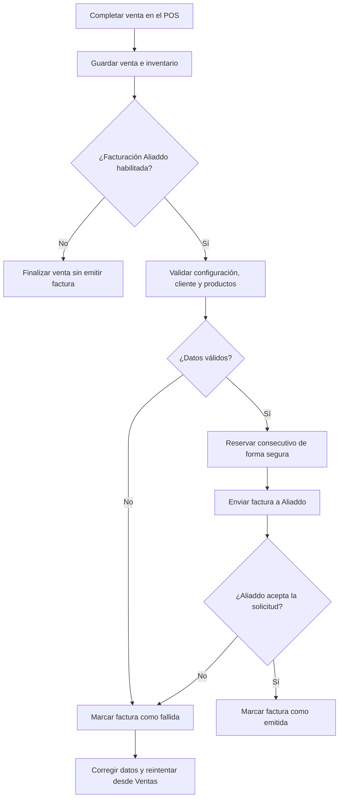

# Guía de parametrización de facturación electrónica con Aliaddo

Esta guía explica cómo configurar **Electronic Invoicing (Aliaddo)** para una
empresa y cómo preparar el sistema para emitir facturas electrónicas desde el
POS. Los nombres entre comillas corresponden a los campos del panel.

> **Importante:** los códigos, la resolución y las credenciales deben ser los
> asignados a la empresa por Aliaddo y la DIAN. Los valores de ejemplo de esta
> guía describen formatos; no deben copiarse como datos reales de facturación.

## 1. Qué hace la integración

Cuando se completa una venta POS, Alfil SaaS usa la configuración de la empresa,
los datos tributarios del cliente y los productos de la venta para construir y
enviar una factura a Aliaddo. La emisión sucede después de guardar la venta: si
Aliaddo rechaza la solicitud o no está disponible, la venta y el movimiento de
inventario permanecen guardados. La factura queda marcada como fallida para
corregir los datos y reintentarla.



## 2. Antes de empezar

Ten disponibles estos datos para la misma empresa que utilizará el POS:

- Acceso de tipo **empresa** a Alfil SaaS.
- Token API y URL HTTPS de Aliaddo para el ambiente que se va a utilizar.
- Para pruebas, el identificador de conjunto de pruebas (`Test set ID`) entregado
  por Aliaddo.
- Datos vigentes de la resolución de numeración de facturación electrónica de
  la DIAN: clave técnica, número, prefijo, rango y fechas de vigencia.
- Códigos documentales, tributarios, de moneda, forma de pago, producto y
  ubicación confirmados por Aliaddo/DIAN.
- Una sucursal, productos y un cliente que tenga identificación tributaria.

No uses credenciales de producción en pruebas. No compartas el token en chats,
capturas de pantalla ni archivos públicos.

## 3. Abrir el panel

1. Inicia sesión con la cuenta de la empresa.
2. Abre **Settings / Ajustes**.
3. Busca la sección **Electronic Invoicing (Aliaddo)**.
4. Completa los campos por grupo, como se describe a continuación.
5. Mantén desactivada la opción de emisión automática mientras reúnes y verificas
   los datos. Actívala al final, antes de guardar la configuración habilitada.

## 4. Configurar la conexión

| Campo | Qué ingresar |
|---|---|
| **Enable automatic electronic invoicing** | Actívalo solo cuando termines y hayas revisado la parametrización. |
| **API base URL** | URL HTTPS del ambiente Aliaddo. El valor inicial es `https://orka.test.aliaddo.net`; para producción usa la URL oficial asignada por el proveedor. |
| **Mode (Test or Production)** | `Test` para el ambiente de pruebas; `Production` únicamente cuando Aliaddo confirme que la cuenta está habilitada para producción. |
| **Test set ID** | Identificador de pruebas entregado por Aliaddo. Es obligatorio si la integración está habilitada en modo `Test`; no es obligatorio en `Production`. |
| **Aliaddo API token** | Pega el token. Se acepta con o sin el prefijo `Bearer`; el servidor elimina ese prefijo si está presente. Si ya hay un token guardado, deja el campo vacío para conservarlo. |

El token se almacena cifrado y no se devuelve al navegador. Si cambias de
ambiente, verifica que URL, token, modo y conjunto de pruebas correspondan todos
al mismo ambiente.

## 5. Configurar factura y numeración

| Campo | Qué ingresar |
|---|---|
| **Invoice document code** | Código del tipo de documento electrónico que Aliaddo indicó para la factura. |
| **Operation type** | Código del tipo de operación solicitado por Aliaddo para este documento. |
| **Document format** | Formato de factura esperado por el endpoint de Aliaddo. |
| **Invoice prefix** | Prefijo de factura configurado con Aliaddo/DIAN. Debe ser compatible con la resolución activa. |
| **Next consecutive number** | Siguiente número que debe utilizar Alfil SaaS dentro del rango autorizado. Debe ser un entero positivo y estar entre los límites de la resolución. |
| **Currency code** | Código ISO 4217 de tres letras de la moneda, por ejemplo `COP` si corresponde a la moneda de la empresa. |
| **Payment method code** | Código de medio/forma de pago admitido por Aliaddo para las ventas de la empresa. |
| **Payment term in days** | Plazo en días. Puede dejarse vacío si no aplica; el sistema lo trata como cero días. El máximo aceptado es 3650. |

El sistema reserva el consecutivo al iniciar la emisión y actualiza el siguiente
valor de forma transaccional para evitar que dos ventas reciban el mismo número.
La reserva ocurre antes de enviar la solicitud: si Aliaddo rechaza el documento o
se pierde la conexión, ese número ya puede haber quedado consumido y el reintento
utilizará el siguiente consecutivo. No reduzcas el contador para reutilizarlo;
consulta con Aliaddo cómo tratar números no emitidos.
Después de guardar, revisa el siguiente consecutivo antes de cambiarlo
manualmente. No lo reinicies ni lo reduzcas por debajo de un número ya utilizado.

## 6. Configurar sucursal, ubicación y productos

Estos campos son valores predeterminados que se envían en los documentos. Usa
los códigos oficiales aplicables a tu compañía y confirma con Aliaddo si todas
las sucursales pueden compartir la misma parametrización.

| Campo | Qué ingresar |
|---|---|
| **Branch region code / Branch region name** | Código DIAN de región/departamento y el nombre correspondiente a la sucursal emisora. |
| **Branch city code / Branch city name** | Código DIAN de municipio y nombre correspondiente a la sucursal emisora. |
| **Country code / Country name** | Código de país de dos letras y nombre. Para Colombia suele usarse `CO` / `Colombia`, sujeto a la configuración confirmada. |
| **Unit of measurement code / Unit of measurement name** | Código y nombre de unidad que acepta Aliaddo para las líneas de producto. |
| **Product standard type / Product standard code** | Tipo y código de clasificación estándar solicitado por Aliaddo para los productos. |
| **Aliaddo tax code** | Código de impuesto que Aliaddo debe recibir para los impuestos de las líneas. Debe concordar con la configuración tributaria real. |

Los nombres y códigos son datos distintos: completa ambos campos de cada par.
El panel no consulta ni valida estos catálogos con Aliaddo; un código
desconocido puede provocar el rechazo de la factura.

## 7. Configurar la resolución DIAN

Transcribe los datos de la resolución electrónica vigente:

| Campo | Qué ingresar |
|---|---|
| **Resolution technical key** | Clave técnica asignada a la resolución. Trátala como información sensible. |
| **Resolution prefix** | Prefijo de la resolución. Si se deja vacío, el sistema usa **Invoice prefix**. |
| **Resolution number** | Número de resolución, como entero positivo. |
| **Authorized initial number** | Primer consecutivo autorizado. |
| **Authorized final number** | Último consecutivo autorizado; no puede ser menor que el inicial. |
| **Resolution valid from / Resolution valid until** | Fechas de inicio y fin de vigencia. La fecha final debe ser igual o posterior a la inicial. |

Antes de habilitar la emisión, confirma que la fecha actual esté dentro del
periodo de vigencia y que **Next consecutive number** esté dentro del rango
autorizado. Al llegar al límite final, solicita o configura la siguiente
resolución antes de emitir nuevas facturas.

## 8. Configurar datos tributarios predeterminados del comprador

| Campo | Qué ingresar |
|---|---|
| **Default person type** | Código predeterminado del tipo de persona aceptado por Aliaddo. |
| **Default tax regime** | Código predeterminado del régimen tributario. |
| **Default identification type code** | Código predeterminado del tipo de identificación. |
| **Default tax responsibility** | Código de responsabilidad tributaria predeterminado. |
| **Default responsibilities** | Código o valor de responsabilidades que solicita Aliaddo. |

Estos valores se usan como respaldo si el dato correspondiente no se encuentra
en la ficha individual del cliente. No reemplazan la identificación tributaria:
para emitir, la venta debe tener un cliente asociado y dicho cliente debe tener
el número de identificación.

### Revisar la ficha del cliente

Antes de probar una factura:

1. Abre **Customers / Clientes** y crea o edita el cliente que se usará en el
   POS.
2. Completa el número de identificación tributaria.
3. Registra el tipo de identificación, tipo de persona, régimen y
   responsabilidades si los conoces para ese cliente.
4. Completa nombres y apellidos fiscales, correo, teléfono y dirección de
   facturación cuando correspondan.
5. Guarda el cliente y confirma que se seleccionará en la venta POS.

Los datos tributarios guardados en la ficha tienen prioridad sobre los valores
predeterminados de la empresa. Verifica los datos fiscales directamente con el
cliente; no uses los datos del cliente genérico/de mostrador para una factura que
requiera identificación.

## 9. Datos que Aliaddo espera al crear una factura

La documentación suministrada describe la creación con
`POST /v2/documents/invoices`. En la operación normal del POS, Alfil SaaS arma
este documento con la venta, el cliente, los productos y la parametrización de
la empresa; no es necesario construir ni enviar el JSON manualmente.

### Campos obligatorios del documento

| Campo | Qué representa y de dónde sale |
|---|---|
| `code` | Código de factura electrónica asignado por Aliaddo; corresponde a **Invoice document code**. |
| `typeOperation` | Código de operación; corresponde a **Operation type**. |
| `mode` | Ambiente `Test` o `Production`; debe coincidir con la cuenta y URL configuradas. |
| `consecutive` | Número siguiente disponible dentro del rango de la resolución. Al emitir desde POS, Alfil SaaS lo reserva de forma segura. |
| `currencyCode` | Código de moneda de tres letras, como `COP` cuando corresponda. |
| `dueAt` | Fecha de vencimiento en formato `AAAA-MM-DD`; se calcula con la fecha de la venta y el plazo configurado. |
| `paymentMeanCode` | Código del medio de pago confirmado con Aliaddo. |
| `resolution` | Objeto de resolución DIAN descrito abajo. |
| `customer` | Comprador con sus datos fiscales. |
| `lines` | Entre 1 y 100 productos o servicios facturados. |
| `totals` | Totales del documento; `totals.amount` es obligatorio. |

La resolución enviada debe contener `key`, `prefix`, `number`, `rangeInitial`,
`rangeFinal`, `validFrom` y `validUntil`. La clave técnica es sensible. El
prefijo, número, rango y vigencia deben coincidir con la resolución activa; no
uses una clave ni un consecutivo de ejemplo.

### Comprador y direcciones

Aliaddo marca como obligatorios `companyName`, `personType`, `regimeType`,
`firstName`, `lastName`, `identification`, `digitCheck`,
`identificationTypeCode` y `responsibilities`. El panel permite valores
predeterminados para algunos códigos tributarios, pero debes revisar que el
documento final tenga todos los datos exigidos para ese comprador, especialmente
nombres, apellidos y dígito de verificación cuando aplique.

`email`, `phone`, `responsibleFor`, `economicActivities`, `BillingAddress` y
`ShippingAddress` son opcionales en el esquema del proveedor. Los nombres de las
direcciones respetan mayúsculas: `BillingAddress` y `ShippingAddress`. Si se
envía una dirección, usa los nombres de propiedad y códigos geográficos que
Aliaddo documenta para ese objeto.

### Productos, impuestos y totales

- Cada línea requiere `code`, `name`, `unitMeasurementCode`, `price` y
  `quantity`. El precio no puede ser negativo y la cantidad debe ser al menos 1.
  Unidad de medida, tipo de estándar y códigos de producto deben proceder de los
  catálogos aplicables.
- `taxes` y `withholdings` son opcionales por línea, pero cuando apliquen deben
  llevar los campos `name`, `code`, `type`, `rate`, `amount` y `base`, con los
  códigos, bases, tarifas y valores calculados de acuerdo con la regla tributaria
  real. No agregues impuestos solo para hacer que un ejemplo cuadre.
- Los descuentos y cargos por línea se definen sobre el valor unitario. Si se
  usan, sus importes (`discountAmount` y `chargeAmount`) deben cuadrar con los
  valores unitarios y la cantidad de esa línea. En cada objeto de descuento o
  cargo se requieren `type`, `rate` y `amount`; `type` es `P` para porcentaje o
  `F` para valor fijo. Para el tipo `F`, Aliaddo indica que `rate` y `amount`
  deben ser iguales.
- No mezcles descuentos o cargos globales de factura con descuentos o cargos
  definidos en las líneas. El esquema también admite propina; su tarifa no
  puede superar el 10 % y el objeto requiere `base`, `rate` y `amount`.
- `totals.amount` es obligatorio. Anticipos, impuestos, retenciones, descuentos
  y cargos totales son opcionales en el esquema (`prepaymentAmount`,
  `taxesAmount`, `withholdingAmount`, `discountAmount` y `chargeAmount`); si se
  envían, deben conciliar con el detalle y las reglas de cálculo de Aliaddo.

### Otros campos opcionales y condiciones

Entre los campos opcionales documentados por el proveedor están `format`,
`testSetId`, `prefix`, `currencyRate`, `orderReference`, `issuedAt`, `branch`,
`periodStartDate`, `periodEndDate`, `deliveryAt`, `incoterms`, `deliveryTerms`,
`terms`, `remark`, `tip`, `discounts` y `charges`. Aplican estas condiciones:

- `incoterms` solo es requerido para una factura de exportación.
- Si se incluye `branch`, Aliaddo requiere nombre, dirección, región y ciudad
  con sus códigos y nombres. El flujo automático de POS de Alfil SaaS envía la
  sucursal y, por tanto, requiere que sus datos estén completos.
- `prefix` tiene un máximo de 8 caracteres en la documentación de Aliaddo.
  Aunque el formulario de Alfil SaaS permita más caracteres, utiliza un prefijo
  de máximo 8 para cumplir el contrato del proveedor.
- `testSetId` es opcional en el esquema de Aliaddo, pero Alfil SaaS lo requiere
  cuando la integración está habilitada en modo `Test`.
- `format` es opcional en la documentación del proveedor, pero es obligatorio
  en el panel y en el endpoint intermediario de Alfil SaaS.
- `deliveryTerms`, `terms` y `remark` admiten hasta 800 caracteres cada uno.

### Ejemplo ilustrativo del cuerpo

Este JSON muestra la forma general del documento. Los códigos entre corchetes
son marcadores y **no son valores utilizables**; reemplázalos únicamente con los
datos oficiales entregados para la empresa. No incluyas el token de autorización
en el cuerpo ni en documentación compartida.

```json
{
  "code": "[CODIGO_FACTURA]",
  "typeOperation": "[CODIGO_OPERACION]",
  "mode": "Test",
  "format": "[FORMATO]",
  "testSetId": "[IDENTIFICADOR_DE_PRUEBAS]",
  "prefix": "[PREFIJO]",
  "consecutive": 1,
  "currencyCode": "COP",
  "dueAt": "AAAA-MM-DD",
  "paymentMeanCode": "[CODIGO_MEDIO_PAGO]",
  "branch": {
    "name": "[SUCURSAL]",
    "address": "[DIRECCION]",
    "regionCode": "[CODIGO_REGION]",
    "regionName": "[REGION]",
    "cityCode": "[CODIGO_CIUDAD]",
    "cityName": "[CIUDAD]"
  },
  "resolution": {
    "key": "[CLAVE_TECNICA]",
    "prefix": "[PREFIJO_RESOLUCION]",
    "number": 1,
    "rangeInitial": 1,
    "rangeFinal": 100,
    "validFrom": "AAAA-MM-DD",
    "validUntil": "AAAA-MM-DD"
  },
  "customer": {
    "companyName": "[NOMBRE_FISCAL]",
    "personType": "[TIPO_PERSONA]",
    "regimeType": "[REGIMEN]",
    "firstName": "[NOMBRES]",
    "lastName": "[APELLIDOS]",
    "identification": "[IDENTIFICACION]",
    "digitCheck": "[DIGITO_VERIFICACION]",
    "identificationTypeCode": "[TIPO_IDENTIFICACION]",
    "responsibilities": "[RESPONSABILIDADES]"
  },
  "lines": [{
    "code": "[CODIGO_PRODUCTO]",
    "name": "[PRODUCTO]",
    "unitMeasurementCode": "[CODIGO_UNIDAD]",
    "price": 10000,
    "quantity": 1
  }],
  "totals": { "amount": 10000 }
}
```

La respuesta y los códigos aceptados dependen del ambiente y de la cuenta
Aliaddo. Valida el documento en pruebas antes de habilitar producción.

## 10. Guardar y probar en el ambiente de pruebas

1. Revisa URL, modo `Test`, token y `Test set ID`.
2. Revisa los códigos, la numeración y la resolución; confirma su vigencia.
3. Activa **Enable automatic electronic invoicing** y selecciona **Save Changes**.
4. Espera el mensaje de confirmación. Si aparecen errores, corrige cada campo
   señalado y guarda de nuevo.
5. Completa una venta de prueba en el POS usando un cliente con identificación
   tributaria y productos válidos.
6. Revisa el aviso de resultado de la venta y después abre **Sales / Ventas**.
   La columna de factura electrónica debe mostrar el consecutivo emitido o el
   estado del intento.
7. Confirma la factura y sus datos en Aliaddo antes de considerar terminada la
   prueba.

Cuando las pruebas sean satisfactorias, solicita la habilitación de producción
a Aliaddo. Después cambia de manera coordinada la URL, el modo, el token y
cualquier dato/resolución que cambie; no reutilices el `Test set ID` de pruebas.

## 11. Cómo interpretar el resultado y reintentar

| Estado o situación | Qué significa / qué hacer |
|---|---|
| **Issued / emitida** | Aliaddo aceptó la solicitud. El prefijo y consecutivo se guardan en la venta. No reintentes una factura ya emitida: el sistema evita duplicarla. |
| **Failed / fallida** | La venta sí se guardó, pero la factura no se emitió. Corrige el token, códigos, resolución, datos del cliente o productos según el mensaje y reintenta desde la fila de la venta. |
| **In progress / pendiente** | Hay una solicitud de emisión en proceso. Espera a que termine antes de iniciar otro intento. |
| Error HTTP de Aliaddo | Revisa la respuesta y confirma con el proveedor que el documento, códigos y ambiente sean válidos. |
| No fue posible conectar | Comprueba que la URL HTTPS sea correcta y que el servicio de Aliaddo esté disponible. |

Un reintento conserva la venta original y no vuelve a descontar inventario. Si
Aliaddo pudo haber recibido el documento pero la aplicación no confirmó la
respuesta, **no reintentes todavía**: busca primero el prefijo y consecutivo en
Aliaddo. Si el proveedor ya registró la factura, coordina la actualización del
estado con soporte antes de volver a emitir para evitar crear un segundo
documento.

## 12. Lista de comprobación

Antes de emitir en producción, confirma todos estos puntos:

- [ ] URL, token y ambiente de producción verificados con Aliaddo.
- [ ] Integración habilitada para la empresa correcta.
- [ ] Resolución DIAN vigente, clave técnica y rangos transcritos correctamente.
- [ ] Próximo consecutivo libre y dentro del rango autorizado.
- [ ] Códigos de documento, operación, moneda, pago, impuesto, ubicación,
  unidades y producto confirmados por Aliaddo/DIAN.
- [ ] Cliente del POS con identificación tributaria y datos fiscales revisados.
- [ ] Emisión de prueba validada en Aliaddo antes de pasar a producción.

## Referencias

- [Integración con facturación electrónica Aliaddo](./aliaddo-integration.md)
- [Especificación del proveedor suministrada para esta integración](./facturación%20electronica.txt)
